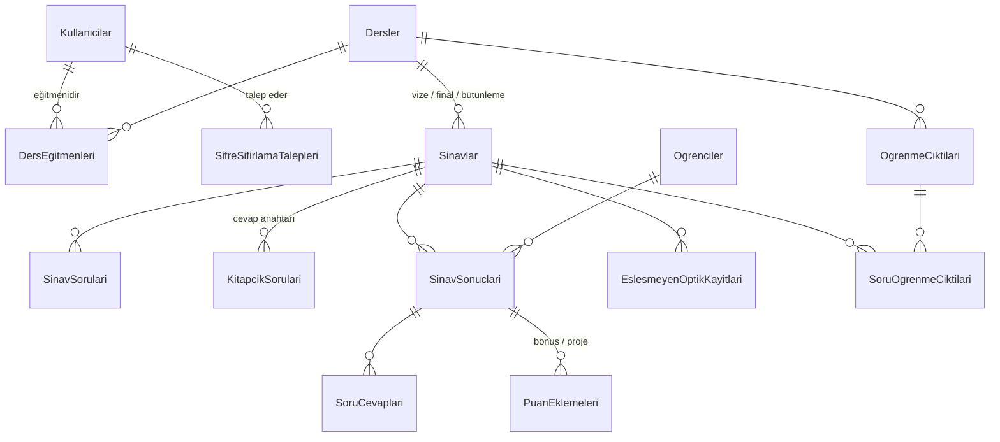

# Veritabanı Tasarımı

PostgreSQL 16 üzerinde Entity Framework Core 8 (code-first) ile oluşturulur. Uygulama açılırken bekleyen
migration'lar otomatik uygulanır ve başlangıç verisi eklenir (`backend/Sds.Api/Data/BaslangicVerisi.cs`).

## Varlık ilişki şeması

## Tablolar

| Tablo | Açıklama |
|---|---|
| `Kullanicilar` | Admin ve öğretim üyeleri. `YoneticiYetkisi` = Admin + Öğretim Üyesi rolü. `SifreDegistirmeli` ilk girişte şifre değişikliğini zorunlu kılar. |
| `SifreSifirlamaTalepleri` | Bekleyen / onaylanan / reddedilen şifre sıfırlama talepleri. |
| `Dersler` | Ders kodu, adı, akademik yıl, dönem, NÖ/İÖ, sınıf. |
| `DersEgitmenleri` | Ders – öğretim üyesi ataması. Öğretim üyesi yalnızca atandığı derslere erişir. |
| `OgrenmeCiktilari` | Dersin öğrenme çıktıları. |
| `Ogrenciler` | OBİS sınıf listesinden gelen öğrenciler; öğrenci numarası sınavlar arası ortak anahtardır. |
| `Sinavlar` | Bir dersin vize, final veya bütünleme sınavı (ders başına her türden bir tane). Format, soru sayısı, kitapçık sayısı, sihirbaz durumu. |
| `SinavSorulari` | Soruların A kitapçığı sırasıyla puanları ve iptal durumu. |
| `KitapcikSorulari` | Her kitapçığın cevap anahtarı ve sorunun A kitapçığındaki karşılığı (kitapçık soru eşleştirme). |
| `SinavSonuclari` | Öğrencinin sınav sonucu: eşleşme durumu, kitapçık, optik cevaplar, doğru/yanlış/boş, ham puan, elle düzeltilen puan. |
| `SoruCevaplari` | Öğrencinin her soruya verdiği cevap (A kitapçığı sırasına çevrilmiş) ve aldığı puan. |
| `PuanEklemeleri` | Bonus ve proje / ek sınav notu eklemeleri. |
| `EslesmeyenOptikKayitlari` | Optik dosyada olup sınıf listesinde bulunamayan kayıtlar (elle eşleştirilir veya göz ardı edilir). |
| `SoruOgrenmeCiktisi` | Öğrenme çıktısı – soru ilişkilendirme matrisi. |
| `NotlandirmaAyarlari` | Vize/final ağırlıkları (%40/%60) ve final alt sınırı (30). |
| `HarfNotuAraliklari` | Selçuk Üniversitesi mutlak değerlendirme harf notu tablosu (AA–FF). |
| `OptikFormAlanlari` | Optik dosyadaki alanların başlangıç/bitiş indeksleri. |

## Başlangıç verisi

### Demo hesaplar

Şifreler sistemin kendi kuralıyla üretilir: **e-postanın @ öncesi + personel no + `*`**.

| Rol | E-posta | Personel no | Şifre |
|---|---|---|---|
| Admin | `admin@selcuk.edu.tr` | 10001 | `admin10001*` |
| Admin + Öğretim Üyesi | `elif.yildirim@selcuk.edu.tr` | 20417 | `elif.yildirim20417*` |
| Öğretim Üyesi | `mehmet.kaya@selcuk.edu.tr` | 20533 | `mehmet.kaya20533*` |

### Demo dersler (2026-2027 Güz)

| Kod | Ders | Sınıf | Eğitmen |
|---|---|---|---|
| 3304701 | Bilgisayar Mühendisliği Uygulamaları | 4 | Elif Yıldırım |
| 3301104 | Ayrık Matematik | 1 | Elif Yıldırım |
| 3302205 | Veri Yapıları ve Algoritmalar | 2 | Mehmet Kaya |

### Varsayılan optik form düzeni

| Alan | Başlangıç | Bitiş |
|---|---|---|
| Öğrenci numarası | 0 | 8 |
| Sınav türü | 9 | 9 |
| Ad soyad | 10 | 30 |
| Kitapçık türü | 31 | 31 |
| Cevaplar | 32 | soru sayısı kadar |
